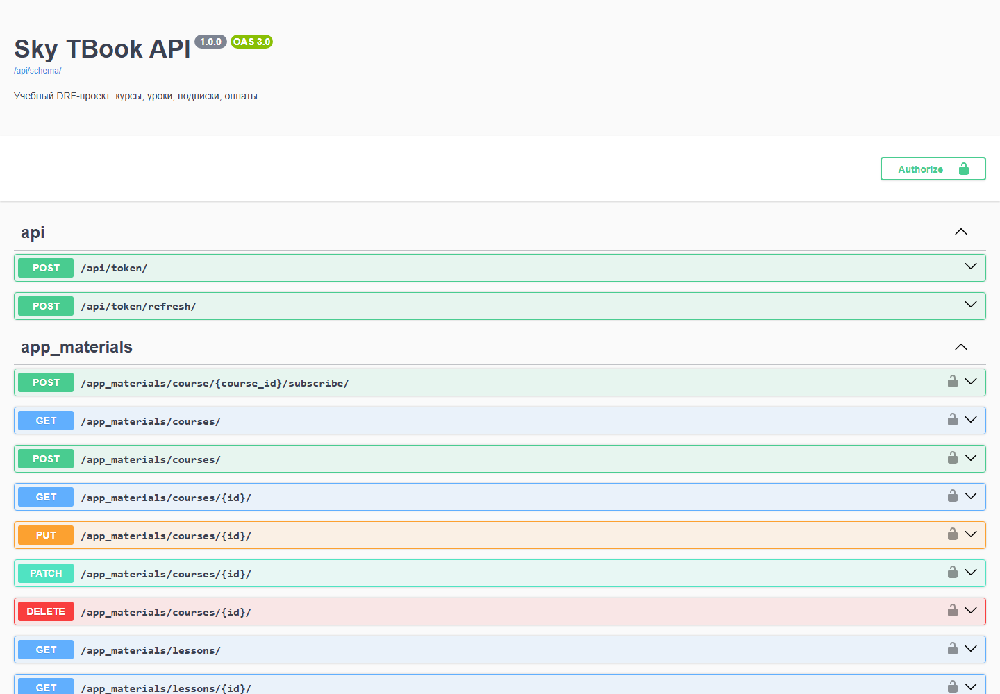
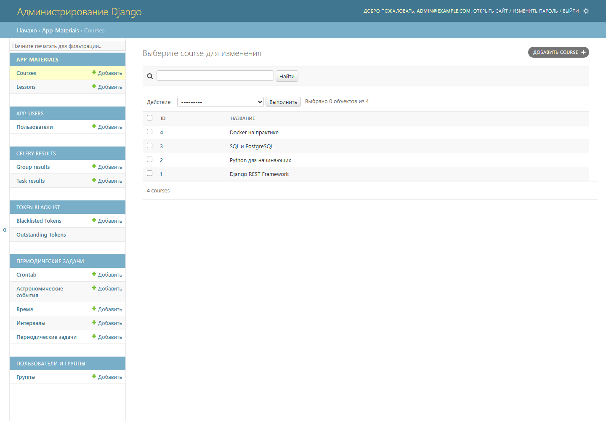
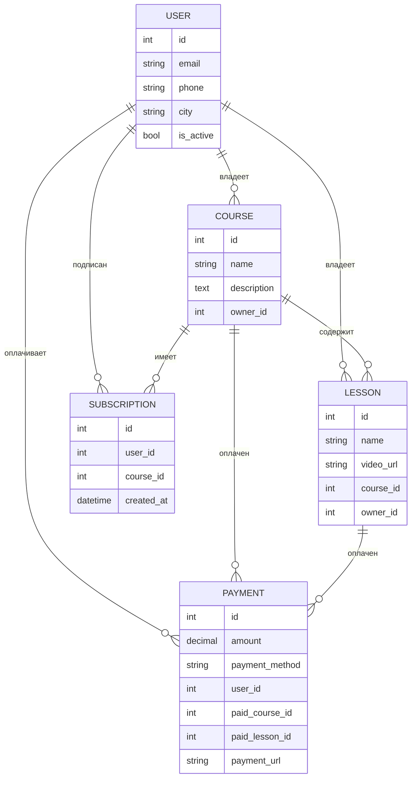

# 📚 Sky TBook

[](https://github.com/Alex-399745146/sky_tbook/actions/workflows/ci.yaml)
[](https://codecov.io/gh/Alex-399745146/sky_tbook)


Backend LMS-платформы: курсы и уроки, кастомные пользователи, платежи, подписки
и email-уведомления. REST API на Django REST Framework, фоновая обработка через Celery.

## 🚀 Возможности

- Курсы и уроки с владельцем и вложенным списком уроков.
- Кастомный пользователь с авторизацией по email.
- JWT-аутентификация (access + refresh).
- Ролевой доступ: владелец объекта, модератор, обычный пользователь.
- Подписка на курс и рассылка писем подписчикам при обновлении курса.
- Платежи: наличные, перевод, Stripe Checkout.
- Автоматическая деактивация пользователей, не входивших более месяца.
- OpenAPI-схема, Swagger UI и ReDoc.
- 60 тестов, покрытие 93%.

## 📸 Скриншоты

Swagger UI со всеми эндпоинтами:



Админка Django:



## 🧰 Стек

| Слой | Технологии |
|---|---|
| Язык | Python 3.13 |
| Web | Django 4.2, Django REST Framework 3.17 |
| База данных | PostgreSQL 16 |
| Аутентификация | Simple JWT |
| Фоновые задачи | Celery, Redis, django-celery-beat, django-celery-results |
| Платежи | Stripe API |
| Документация | drf-spectacular (OpenAPI, Swagger, ReDoc) |
| Инфраструктура | Docker, Docker Compose, Poetry |
| Качество кода | pytest, coverage, black, isort, flake8, mypy |

## 🗂️ Схема данных



## 🛠️ Быстрый старт

### Docker Compose

```bash
git clone https://github.com/Alex-399745146/sky_tbook.git
cd sky_tbook
cp .env.docker.example .env.docker
# отредактируйте .env.docker: SECRET_KEY, DB_PASSWORD, ключи Stripe и почты
docker compose --env-file .env.docker up --build
```

Приложение будет доступно на `http://localhost:8000/`, Swagger — на
`http://localhost:8000/api/schema/swagger/`.

### Локально

Требуются Python 3.13, Poetry, PostgreSQL и Redis.

```bash
git clone https://github.com/Alex-399745146/sky_tbook.git
cd sky_tbook
poetry install
cp .env.example .env
# укажите в .env параметры PostgreSQL, Redis и SECRET_KEY
poetry run python manage.py migrate
poetry run python manage.py createsuperuser
poetry run python manage.py loaddata users/fixtures/groups.json
poetry run python manage.py runserver
```

Celery worker и Beat запускаются отдельными процессами:

```bash
poetry run celery -A config worker -P solo --loglevel=info
poetry run celery -A config beat --loglevel=info
```

Расписание задачи деактивации неактивных пользователей создаётся командой:

```bash
poetry run python manage.py setup_deactivate_inactive_users_task
```

## ⚙️ Переменные окружения

| Переменная | Назначение | Пример |
|---|---|---|
| `SECRET_KEY` | Ключ Django | длинная случайная строка |
| `DEBUG` | Режим отладки | `False` |
| `ALLOWED_HOSTS` | Разрешённые хосты через запятую | `localhost,127.0.0.1` |
| `DB_NAME` | Имя базы | `sky_tbook` |
| `DB_USER` | Пользователь БД | `sky_user` |
| `DB_PASSWORD` | Пароль БД | — |
| `DB_HOST` | Хост БД | `localhost` / `db` в Docker |
| `DB_PORT` | Порт БД | `5432` |
| `REDIS_URL` | Брокер Celery | `redis://127.0.0.1:6379/0` |
| `STRIPE_PUBLISHABLE_KEY` | Публичный ключ Stripe | `pk_test_...` |
| `STRIPE_SECRET_KEY` | Секретный ключ Stripe | `sk_test_...` |
| `EMAIL_HOST` | SMTP-сервер | `smtp.gmail.com` |
| `EMAIL_PORT` | Порт SMTP | `587` |
| `EMAIL_HOST_USER` | Логин SMTP | — |
| `EMAIL_HOST_PASSWORD` | Пароль приложения SMTP | — |

`.env`, `.env.docker` и файлы с реальными ключами в репозиторий не попадают.

## 🌍 API

| Раздел | Эндпоинты |
|---|---|
| Документация | `GET /api/schema/`, `/api/schema/swagger/`, `/api/schema/redoc/` |
| JWT | `POST /api/token/`, `POST /api/token/refresh/` |
| Регистрация | `POST /app_users/users/register/` |
| Пользователи | `GET/PUT/PATCH/DELETE /app_users/users/{id}/` |
| Курсы | `GET/POST /app_materials/courses/`, `GET/PUT/PATCH/DELETE /app_materials/courses/{id}/` |
| Уроки | `GET /app_materials/lessons/`, `POST /app_materials/lessons/create/`, `GET/PUT/PATCH/DELETE /app_materials/lessons/{id}/` |
| Подписка | `POST /app_materials/course/{id}/subscribe/` |
| Платежи | `GET /app_users/payments/`, `POST /app_users/payments/create/` |

Списки курсов, уроков, пользователей и платежей пагинированы:
`?page=1&page_size=10` (максимум `page_size=20`). Платежи фильтруются по
`paid_course`, `paid_lesson`, `payment_method`, сортируются по `payment_date` и
`amount`, поиск — по email пользователя.

## 🛡️ Права доступа

| Действие | Обычный пользователь | Владелец объекта | Модератор |
|---|---|---|---|
| Каталог курсов и уроков | ✅ | ✅ | ✅ |
| Создать курс или урок | ✅ | ✅ | ❌ |
| Редактировать свой объект | ❌ | ✅ | ✅ |
| Редактировать чужой объект | ❌ | ❌ | ✅ |
| Удалить свой объект | ❌ | ✅ | ❌ |
| Удалить чужой объект | ❌ | ❌ | ❌ |
| Список пользователей | ❌ | ❌ | ✅ |
| Свой профиль | ✅ | ✅ | ✅ |
| Чужой профиль | ❌ | ❌ | ✅ |
| Свои платежи | ✅ | ✅ | ✅ |
| Все платежи | ❌ | ❌ | ✅ |

Модератор — суперпользователь или участник группы `moderators`.

## ✅ Тесты

```bash
poetry run pytest
```

- 60 тестов: регистрация, JWT, роли, права владельца и модератора,
  платежи, подписки, email-уведомления.
- Покрытие — **93%** (`pytest --cov`, без миграций и самих тестов).
- Тесты используют SQLite и eager-режим Celery, внешние сервисы замоканы.

CI (`.github/workflows/ci.yaml`) запускает black, isort, flake8, mypy, тесты
и загружает coverage в Codecov. Сборка Docker-образа выполняется после
успешного lint и test.

## 🚢 Деплой

Workflow `.github/workflows/deploy.yaml` готов к работе, но запускается
**только вручную** (`workflow_dispatch`): демо-сервер выключен, автоматический
деплой при пуше отключён. Для запуска нужны секреты репозитория:

`SSH_HOST`, `SSH_USER`, `SSH_PRIVATE_KEY`, `SSH_PORT`, `SECRET_KEY`, `DEBUG`,
`ALLOWED_HOSTS`, `DB_NAME`, `DB_USER`, `DB_PASSWORD`, `DB_HOST`, `DB_PORT`,
`REDIS_URL`. Переменная `APP_URL` (Settings → Variables) включает healthcheck.

## ✍️ Автор

**Александр Бачевский** — Python-разработчик (backend, Django/DRF).

- GitHub: [Alex-399745146](https://github.com/Alex-399745146)
- Email: bachevskiiaa@gmail.com
